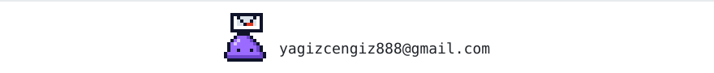

<picture>
  <source media="(prefers-color-scheme: dark)" srcset="assets/header-dark.svg" />
  
</picture>

I study computer engineering at Manisa Celal Bayar University. I build full-stack web apps with .NET and React, and I enjoy getting involved in projects beyond the web, from AI tools to robotics and research.

### Now

- Finished a software internship at Bilsa Yazılım in August 2026, working with ASP.NET Core and React.
- Member of [Team MAGNESIA](https://github.com/yagizcngz/teknofest-ika-lydia), a TEKNOFEST 2026 autonomous ground vehicle team.
- Part of a TÜBİTAK 2209-B research project on EV energy management.

### Projects

| Project | What it is | Built with |
| :-- | :-- | :-- |
| [course-management-platform](https://github.com/yagizcngz/course-management-platform) | Course platform with separate roles for admins, teachers and students, JWT auth and enrollment flows | ASP.NET Core 10, EF Core, React 19, TypeScript |
| [python-ai-agent](https://github.com/yagizcngz/python-ai-agent) | Coding agent with a terminal UI that runs on cloud models or locally through Ollama | Python, Textual, OpenRouter, Ollama |
| [smart-product-assistant](https://github.com/yagizcngz/smart-product-assistant) | Mobile assistant that recommends products using a small retrieval pipeline | Node.js, Express, Gemini API, React Native |
| [LibraryManagementSystem](https://github.com/yagizcngz/LibraryManagementSystem) | Library app for book inventory, member records and loan history | Java |

### Stack

**Backend** &nbsp; C#, ASP.NET Core, Entity Framework Core, SQL Server, Node.js 
**Frontend** &nbsp; React, TypeScript, Tailwind CSS, React Native 
**Also** &nbsp; Python, C++, Java, Arduino

### Activity

<a href="mailto:yagizcengiz888@gmail.com">
  <picture>
    <source media="(prefers-color-scheme: dark)" srcset="assets/footer-dark.svg" />
    
  </picture>
</a>
